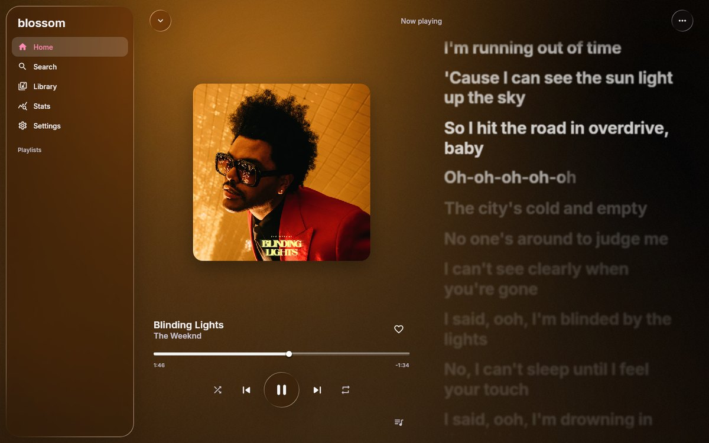
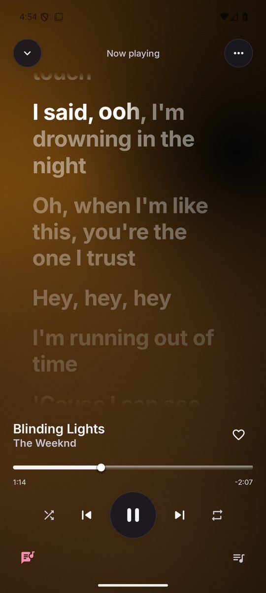
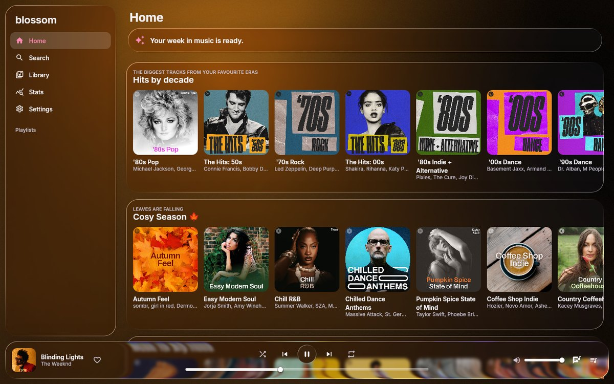
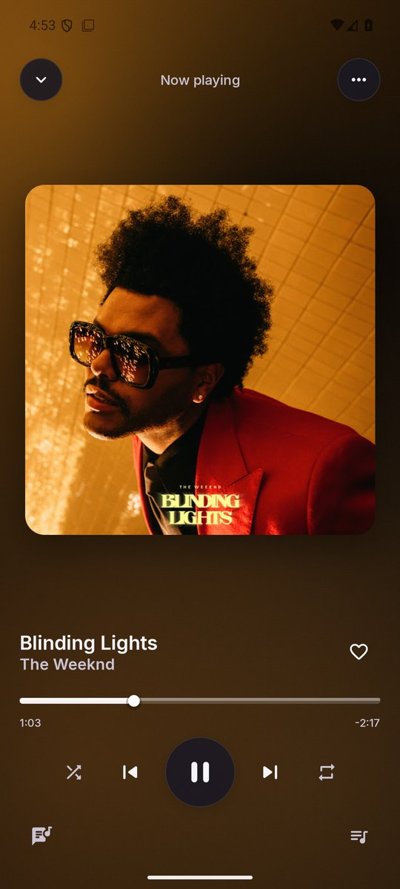

# blossom

A free, open-source, liquid-glass music player for Android, Windows, Linux and (in beta) iPhone.

It's free for everyone: no ads, no paid tier, no analytics, no blossom account.

<p>


</p>
<p>


</p>

## What it does

- **Streams YouTube Music** without an account (signing in is optional), plus SoundCloud and untitled.stream links.
- **Plays your own files** (MP3, FLAC, M4A/AAC, Ogg, Opus, WAV) from folders you choose.
- **Imports playlists** from Spotify, YouTube Music, SoundCloud and untitled.stream by pasting or sharing a link, and
  finds a playable match for every song. Signing in to Spotify (Android) also imports private playlists and Liked Songs.
- **Saves music offline** in an encrypted cache, with a storage limit and Wi-Fi-only downloads.
- **Synced lyrics**, word by word where available, full screen on desktop.
- **Listening stats** per week, month and year, and a Wrapped story you can export and share.
- **Sync between your devices** through storage you already own: a folder (Syncthing and the like), WebDAV,
  Google Drive (desktop) or Dropbox. Or pair devices on your network with a QR code or eight words. No blossom server.
- Crossfade and gapless playback, a 10-band equalizer, a sleep timer, Last.fm and ListenBrainz scrobbling, Discord
  status (desktop, off by default), system media controls (Android notification, Windows SMTC, Linux MPRIS).
- Glass you can turn down (Settings → Appearance), Reduce motion, large-text support, full keyboard navigation.

## Install

Download the installer for your device from the [latest release](https://github.com/velosako3/blossom/releases/latest).
blossom then updates itself: it offers each new release and installs it when you tap it.

| Platform | File | Notes |
| --- | --- | --- |
| Android 8+ | `blossom-<version>-android-<abi>.apk` | Pick `arm64-v8a` for most phones, or `universal`. Allow installing from your browser or file manager. |
| Windows 10/11 (x64) | `blossom-<version>-windows-x64.msi` | Or the `-portable.zip`: unzip and run `blossom.exe`. |
| Linux (x86_64) | `blossom-<version>-linux-x86_64.AppImage` | `chmod +x` and run. Or `sudo apt install ./blossom_<version>_amd64.deb`. |
| iPhone / iPad (iOS 16+), beta | `blossom-<version>-ios-unsigned.ipa` | Install with [SideStore](https://sidestore.io) or [AltStore](https://altstore.io), which sign it with your own Apple ID (free accounts re-sign every 7 days). For now: Home, Search, Library, playlists, Now playing with lyrics; no import, sync, offline saving or stats yet. |

Each release has `SHA256SUMS` files to check downloads against. The Windows installer isn't code-signed yet, so Windows
may show "Windows protected your PC": choose **More info → Run anyway**. Pre-releases named "test build" are for testing.

## Building

JDK 21 and the Android SDK (`sdk.dir` in `local.properties`). See [CLAUDE.md](CLAUDE.md) for all commands:

```
./gradlew check                    # every test
./gradlew :composeApp:run          # the desktop app
./gradlew :androidApp:assembleDebug
```

Optional services (Google Drive, Dropbox, Last.fm, Discord) need client IDs in a git-ignored `secrets.properties`;
without them those options are simply hidden. See [docs/RELEASING.md](docs/RELEASING.md).

## Credits

blossom builds on two open-source players:
[BitChord](https://github.com/kushagrasinghx/BitChord) (YouTube Music client, lyrics providers, Spotify reading,
sign-in flows) and [Spotube](https://github.com/KRTirtho/spotube) (the libVLC desktop engine and system media
controls). Thank you. Every library and its license is listed in Settings → About → Open-source licenses, and in
[NOTICE](NOTICE).

## License

[AGPL-3.0-or-later](LICENSE). Files ported from BitChord stay GPL-3.0-only, which the AGPL allows combining with.
